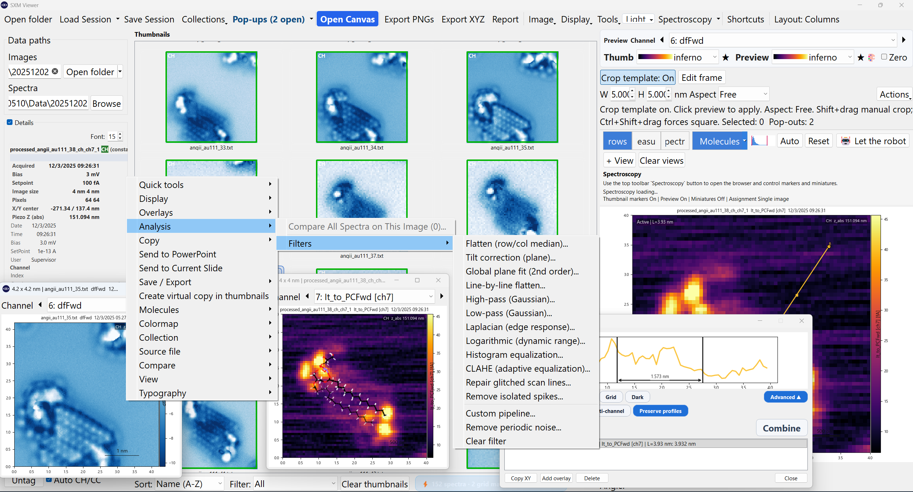
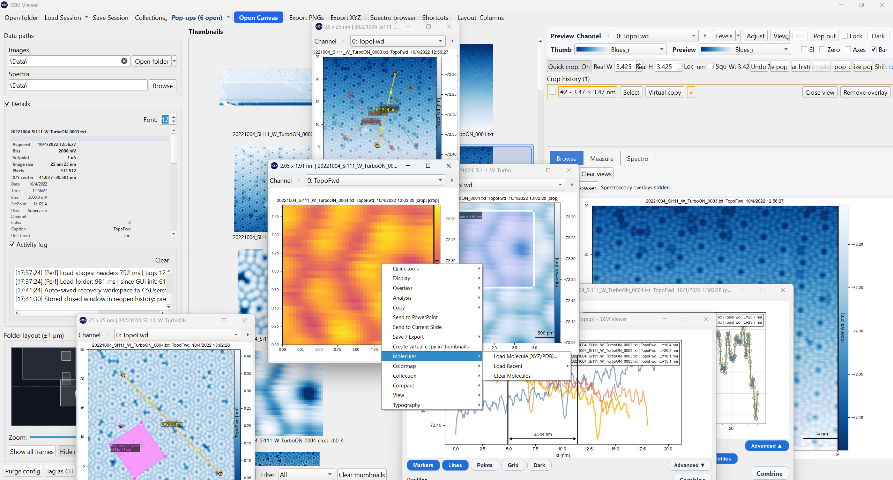

# SXM Viewer

SXM Viewer is a Python desktop application for browsing, analysing and visualising scanning probe microscopy (SPM) data. It reads Anfatec/Omicron data natively and Nanonis `.sxm`, `.dat` and `.3ds` files through a conversion adapter.

<p align="center">
  
</p>
---


## Documentation

Full documentation is available at:

https://ex-libris.github.io/sxm_viewer/

Key pages:
- Installation: https://ex-libris.github.io/sxm_viewer/getting-started/installation/
- First Steps: https://ex-libris.github.io/sxm_viewer/getting-started/first-steps/
- Profiles and Measurements: https://ex-libris.github.io/sxm_viewer/image-analysis/profiles/

---

## Overview

SXM Viewer provides an integrated environment for:

- Fast browsing of large SPM datasets
- Image analysis (profiles, angles, cropping, filtering)
- Spectroscopy visualization (traces, matrix scans, KPFM)
- Overlay tools (molecules, metadata, scale bars)
- Publication-ready figure composition (canvas)
- Session and collection management




## Quick start

```powershell
git clone https://github.com/Ex-libris/sxm_viewer.git
cd sxm_viewer
conda create -n sxmviewer python=3.11
conda activate sxmviewer
cd .\scripts
python -m pip install -r .\requirements.txt
cd ..
python -m sxm_viewer
```

Alternatively, install it as a package with `python -m pip install .` (add `.[animation]` for drift-animation export) and launch it with `sxm-viewer`.

See the full installation guide in the MkDocs site for the Windows installer helper and troubleshooting notes. The application is developed and tested on Windows.


## What's new

See [CHANGELOG.md](CHANGELOG.md).

## How to cite

If SXM Viewer contributes to work you publish, please cite it. Citation metadata is in [CITATION.cff](CITATION.cff); GitHub's "Cite this repository" button generates APA and BibTeX from it. Each release is archived on Zenodo with its own DOI.

> Mallada, B., Rauschenbach, S. *SXM Viewer* [Computer software]. https://github.com/Ex-libris/sxm_viewer

## License

SXM Viewer is released under the MIT License (see [LICENSE](LICENSE)).

Some bundled files are under other licenses: the Nanonis reader [nanonispy2](https://pypi.org/project/nanonispy2/) (MIT) and the force-deconvolution MATLAB scripts by Welker, Illek and Giessibl (CC BY 2.0). See [THIRD_PARTY_NOTICES.md](THIRD_PARTY_NOTICES.md) for details, the methods implemented and their references.

## Use of AI tools

Parts of the code and documentation were written with the assistance of AI tools: Claude Code (Anthropic) and ChatGPT (OpenAI). All code was directed and reviewed by the author, and scientific methods were checked against the cited references and real instrument data. The author takes full responsibility for the software. [CLAUDE.md](CLAUDE.md) holds the architecture and design notes used during development.

## Acknowledgements

SXM Viewer is developed by Benjamin Mallada in the group of Prof. Stephan Rauschenbach, Department of Chemistry, University of Oxford.

This work was funded by the Biotechnology and Biological Sciences Research Council (BBSRC, UK Research and Innovation), grant [BB/W017024/1](https://gtr.ukri.org/projects?ref=BB%2FW017024%2F1).

Thanks to Olivier Durif, Alejandro Lynch Gonzalez and Michael Foster for code contributions.

SXM Viewer was inspired by [LMAPper](https://sourceforge.net/p/spm-and-mol-viewer/wiki/Pre-print/) (L. M. A. Perdigão) and [WSxM](https://wsxm.eu/) (Horcas et al., *Rev. Sci. Instrum.* 78, 013705 (2007)). Anfatec/Omicron support follows the file structures defined by Anfatec Instruments AG.
